# Capital Gains

* [Overview](#overview)
    - [Flow](#flow)
    - [Use cases](#use-cases)
* [Installation](#installation)
    - [Repository](#repository)
    - [Configuration](#configuration)
    - [Tests](#tests)
    - [Review](#review)
    - [Reports](#reports)

## Overview

Command-line (CLI) application that calculates the tax owed on profits or losses from stock market operations.

The application reads JSON arrays of buy and sell operations from `stdin`, either one array per line or a single array
spread over several lines, and writes one JSON array of taxes per input array to `stdout`. Each array is processed
independently, with an in-memory portfolio that keeps the current share quantity, the weighted-average unit cost, and
the accumulated losses. Nothing is kept between arrays.

### Flow



Sources: [capital-gains-flow.html](docs/diagrams/capital-gains-flow.html).

### Use cases

- [Register buy](docs/USE_CASES.md#register-buy)
- [Register sell](docs/USE_CASES.md#register-sell)
- [Calculate capital gain](docs/USE_CASES.md#calculate-capital-gain)

## Installation

### Repository

To clone the repository using the command line, run:

```bash
git clone https://github.com/gustavofreze/capital-gains.git
```

### Configuration

To install project dependencies locally, run:

```bash
make configure
```

To run the capital gains calculation reading operations from `stdin`, run:

```bash
make calculate < use_case.txt
```

With the operations in [use_case.txt](use_case.txt), the result written to `stdout` is:

```json
[{"tax":0.00},{"tax":80000.00},{"tax":0.00},{"tax":60000.00}]
```

### Tests

Run all tests with coverage:

```bash
make test
```

### Review

Run static code analysis:

```bash
make review
```

### Reports

Open coverage reports in the browser:

```bash
make show-reports
```

> You can check other available commands by running `make help`.
